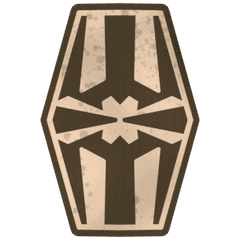

# Sabacc Droid: Discord Bot

*Supports Corellian Spike, Coruscant Shift, Kessel, and Traditional Sabacc*

Welcome to **Sabacc Droid**! This project brings Sabacc, the classic Star Wars card game, to life in two versions:

1. **Console Version (`sabacc_console.py`):** Play Corellian Spike Sabacc in your terminal or IDE. This is the original prototype of Sabacc Droid.
2. **Discord Bot Version (`sabacc_droid.py`):** Play Corellian Spike, Coruscant Shift, Kessel, and Traditional Sabacc on Discord. Run your own copy of the bot, or [**add Sabacc Droid to your server**](https://discord.ly/sabaac-droid).

Experience Sabacc as seen in *Solo: A Star Wars Story*, *Galaxy's Edge*, *Galactic Starcruiser*, *Star Wars Outlaws*, and *Star Wars Rebels*.

Created by **Abubakr Elmallah** on **November 14, 2024**.

[**Add Sabacc Droid to Your Discord Server**](https://discord.ly/sabaac-droid)

<a href="https://discord.ly/sabaac-droid">
  
</a>

## Features

### Console Version (Corellian Spike Sabacc)

- **Original Prototype:** See the version that came before Sabacc Droid.
- **Classic Gameplay:** Play Corellian Spike Sabacc against a computer opponent.
- **Simple Interface:** A text-based interface that's easy to navigate.

### Discord Bot Version (All Four Variants)

- **Multiplayer:** Play with up to 8 players in any Discord channel.
- **Solo Play:** Start a game alone and Lando Calrissian AI takes a seat and plays real turns against you, moving toward the target like any careful player (he never peeks at the deck).
- **Private Hands:** Click **Play Turn** to see your own cards; nobody else can. **Ranks As** shows what your hand counts as right now ("Sabacc Pair", or "Nulrhek, 3 away from 0").
- **Game Log:** Each turn message turns into a one-line record of what happened ("draws a card", "discards `-3`"), for players and Lando alike, so the channel reads like the table.
- **The Reveal:** The results show every hand as one picture in finishing order, with 🥇🥈🥉 places. Coruscant Shift shows its gold and silver dice when the game starts, and Kessel shows the Impostor dice you roll.
- **No Stuck Games:** A player gets a ping with a minute left on their turn and stands automatically after 5 minutes, and a lobby nobody starts closes after an hour.
- **Play Again:** Reopen a lobby with the same settings from the results, even after the bot restarts. Everyone from the last game gets pinged for the rematch. If the bot restarts for an update mid-game, the table is told why and gets a Play Again button too.
- **Game Variants:**
  - **[Corellian Spike Sabacc](https://starwars.fandom.com/wiki/Corellian_Spike):** Seen in *Solo: A Star Wars Story* and *Galaxy's Edge*. A fast-paced, 3-round game where players aim for a total of **0**.
  - **[Coruscant Shift Sabacc](https://starwars.fandom.com/wiki/Coruscant_Shift):** Played on the *Halcyon* at *Galactic Starcruiser*. Dice set the target number and a target suit for tiebreakers.
  - **[Kessel Sabacc](https://starwars.fandom.com/wiki/Kessel_Sabacc):** Seen in *Star Wars Outlaws*. Each player holds exactly 2 cards, with special **Impostor** and **Sylop** cards.
  - **[Traditional Sabacc](https://starwars.fandom.com/wiki/Sabacc):** Seen in *Star Wars Rebels*. A high-stakes game where players aim for **+23 or -23**.
- **Built-In Rules:** View the rules for every variant directly in Discord.

## Commands

| Command | Description |
| --- | --- |
| `/sabacc` | Choose a Sabacc variant to play |
| `/random` | Start a random Sabacc variant (use 0 for random rounds or cards) |
| `/corellian_spike` | Start a Corellian Spike Sabacc game with optional custom settings (rounds, starting cards, discarding) |
| `/coruscant_shift` | Start a Coruscant Shift Sabacc game with optional custom settings (rounds, starting cards) |
| `/kessel` | Start a Kessel Sabacc game with optional custom settings (rounds) |
| `/traditional` | Start a Traditional Sabacc game with optional custom settings (starting cards, discarding) |
| `/help` | Show how to use Sabacc Droid |

## Game Rules

Every variant aims for a hand total close to its target (0, a dice-determined number, or +23/-23), but each has its own deck and rules.
For more on Sabacc rules, card designs, and gameplay resources, visit **[Hyperspace Props](https://hyperspaceprops.com/sabacc-resources/)**.

### Default Settings

- **Corellian Spike Sabacc:** 3 rounds, 2 starting cards.
- **Coruscant Shift Sabacc:** 2 rounds, 5 starting cards.
- **Kessel Sabacc:** 3 rounds, 2 starting cards.
- **Traditional Sabacc:** No set number of rounds (play continues until someone calls Alderaan), 2 starting cards.

### Corellian Spike Sabacc

- **Deck:** 62 cards: -10 to -1 and +1 to +10 (three of each), plus 2 Sylops (0).
- **Rounds:** 3 by default.
- **Actions:** Draw, Replace, Discard (off by default; turn it on in the lobby), Stand, or Junk.
- **Target:** Closest to 0.
- **Special Hands:** Pure Sabacc, Fleet, Yee-Haa, and more.

### Coruscant Shift Sabacc

- **Deck:** 62 cards: +1 to +10 and -1 to -10 in each of three suits (●, ▲, ■), plus 2 Sylops (0).
- **Dice:**
  - **Gold Die:** Sets the target number (-10, +10, -5, +5, 0, 0).
  - **Silver Die:** Sets the target suit (●, ▲, ■) for tiebreakers.
- **Rounds:** 2 by default.
- **Target:** Closest to the gold die's target number.
- **Tiebreakers:** Closest to the target number, then most cards in the target suit, then highest total, then highest single positive card. If still tied, the game ends in a tie.

### Kessel Sabacc

- **Deck:** Two decks, Sand (positive) and Blood (negative), with 22 cards each (44 total), including Impostors and Sylops.
- **Hand Limit:** Exactly **2 cards** (1 positive, 1 negative).
- **Rounds:** 3 by default.
- **Actions:** Draw (then keep either the drawn card or your existing one), Stand, or Junk.
- **Target:** Closest to 0.
- **Special Cards:**
  - **Impostor (Ψ):** Roll two dice at the end of the game and pick one value.
  - **Sylop (Ø):** Takes the value of the other card in your hand.
- **Special Hands:** Pure Sabacc, Prime Sabacc, and more.

### Traditional Sabacc

- **Deck:** 76 cards: 4 suits of 15 cards, plus 16 special cards with unique values.
- **Hand Limit:** None; players can hold any number of cards.
- **Rounds:** No set number; play continues until someone calls **Alderaan**.
- **Actions:** Draw, Replace, Discard (off by default; turn it on in the lobby), Stand, Junk, or Call Alderaan.
- **Target:** Closest to **+23 or -23**.
- **Special Hands:**
  - **Idiot's Array (0, +2, +3):** Beats every other hand.
  - **Natural Sabacc (+23 or -23):** Beats every hand except Idiot's Array.
  - **Fairy Empress (-2, -2, read as -22):** Beats a normal 22 but loses to a Natural Sabacc.

## Getting Started

### Console Version

1. **Install Python 3.12 or higher.** Earlier versions are not supported.
2. **Run the game:**
    ```bash
    python src/sabacc_console.py
    ```

### Discord Bot Version

- **Add the bot to your server:** [Invite Link](https://discord.ly/sabaac-droid)
- **Run your own copy:**
  1. Create a Discord bot. [This video](https://www.youtube.com/watch?v=UYJDKSah-Ww&t=330s) walks through the setup.
  2. Use **Python 3.12 or newer**. The server and the deploy workflow use the version in [`.python-version`](.python-version). Install the dependencies:
      ```bash
      pip install -r requirements.txt
      ```
  3. Set `DISCORD_TOKEN` in the environment, or create a `.env` file in the repository folder containing `DISCORD_TOKEN=your-bot-token`.
  4. Start the bot:
      ```bash
      cd src/sabacc_droid
      python sabacc_droid.py
      ```
  5. To check everything without connecting to Discord (hand rankings, Lando's moves, every picture, and 240 simulated games), run `python sabacc_droid.py --self-test`.

## Project Layout

Each variant has one file in [`src/sabacc_droid`](src/sabacc_droid), and everything they share lives in a few small modules.

| File | What it holds |
| --- | --- |
| `sabacc_droid.py` | Startup, the slash commands, and routing every button to its game or menu |
| `game.py` | What every variant shares: the lobby, turns, timers, Lando's seat, and the results |
| `corellian_spike.py`, `coruscant_shift.py`, `kessel.py`, `traditional.py` | One variant each: its deck, turn actions, hand rankings, and rules |
| `help.py` | `/help`, the `/sabacc` menu, and the variant comparison |
| `cards.py` | Drawing every picture: hands, the table of final hands, and dice |
| `theme.py` | The shared colors, images, icons, links, and reply conventions |
| `self_test.py` | The checks behind `--self-test` |
| `images/` | Card art, 240 pixels tall with at most 256 colors |

The conventions every reply follows are written at the top of [`src/sabacc_droid/theme.py`](src/sabacc_droid/theme.py), the same ones [Aurebesh Droid](https://github.com/TheAbubakrAbu/Aurebesh-Droid) follows, and the self-test checks them. On top of those, cards are written as code chips like `+5` `-3`, game log lines are in the present tense ("✋ @Han stands."), and private results of your own move start with "You" ("You Drew a Card"). Every button id is either a game's (`g:<game>:<turn>:<action>`), which stops working once that turn is over, or carries everything it needs (`start:`, `again:`, `rules:`), so it keeps working after a restart.

## Hosting

The public bot runs on an Oracle Cloud server as a systemd service.

On every push to `main`, the [GitHub Actions workflow](.github/workflows/deploy.yml) runs the self-test, and only if it passes, moves the server to the commit it tested, installs the requirements, and restarts the bot. Before it stops, the bot tells every unfinished game why it is ending and offers Play Again. The server checks the bot every 2 minutes and messages the owner on Discord if it goes down.

## Bot Lists

Sabacc Droid is on [top.gg](https://top.gg/bot/1306557976592515163), [Discord Bot List](https://discordbotlist.com/bots/sabaac-droid), [Discord Bots](https://discord.bots.gg/bots/1306557976592515163), [Discordlist](https://discordlist.gg/bot/1306557976592515163) and Discord's App Directory. It is waiting for review on Discord Extreme List, Botlist.me, Topbot.gg, TheDiscordList and Radarcord. [`docs/bot-lists.md`](docs/bot-lists.md) has every listing's link, status and settings, and the text they all use.

## More Star Wars

- **[Aurebesh Droid](https://github.com/TheAbubakrAbu/Aurebesh-Droid)**: A Discord bot that translates text into Aurebesh and 13 more Star Wars scripts. [Add it to your server](https://discord.ly/aurebesh-droid).
- **[Datapad | Aurebesh Translator](https://apps.apple.com/us/app/datapad-aurebesh-translator/id6450498054?platform=iphone)**: An immersive Aurebesh translator with a themed keyboard.
- **[Aurebesh Translator](https://apps.apple.com/us/app/aurebesh-translator/id6670201513?platform=iphone)**: A free, offline, ad-free translator.

## Privacy & Data

**Sabacc Droid** respects your privacy:
- **No Personal Data Collected:** Only temporary game data is stored.
- **Secure & Compliant:** Fully follows Discord's Terms of Service and Privacy Policy.

## License

This project is licensed under the [MIT License](LICENSE). Feel free to use, modify, and distribute the code, but please provide attribution.

## Feedback & Contact

I'd love to hear your thoughts! Open an issue, or reach out with feedback, feature requests, or questions:
- **Email:** contact@abubakrelmallah.com
- **Website:** [abubakrelmallah.com](https://abubakrelmallah.com/)
- **LinkedIn:** [Abubakr Elmallah](https://www.linkedin.com/in/abubakr-elmallah-416a0b273/)
