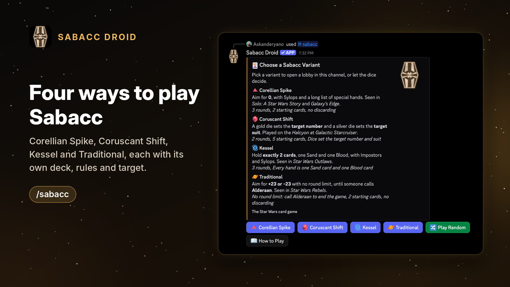
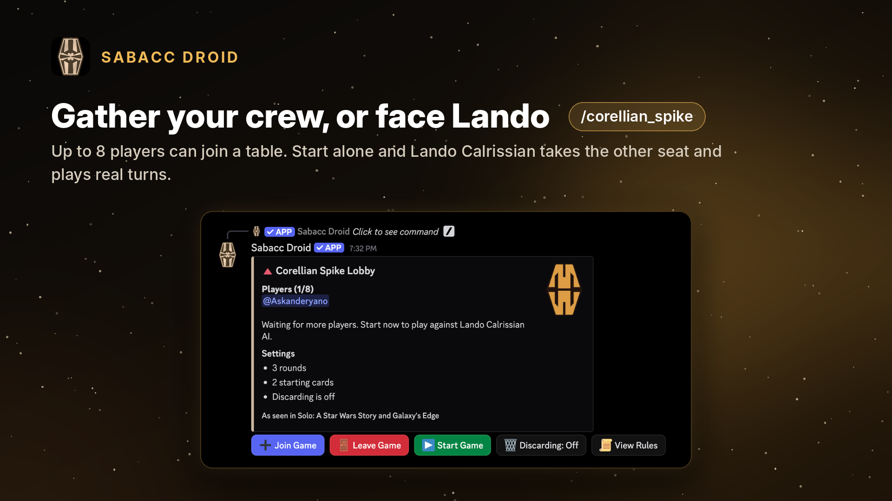
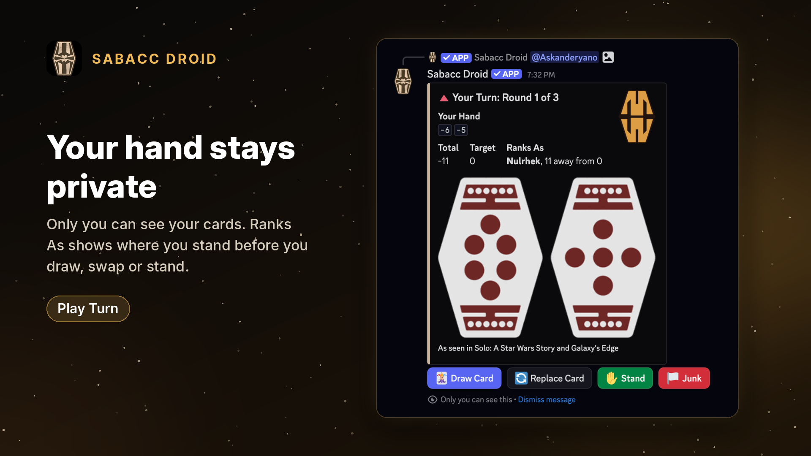
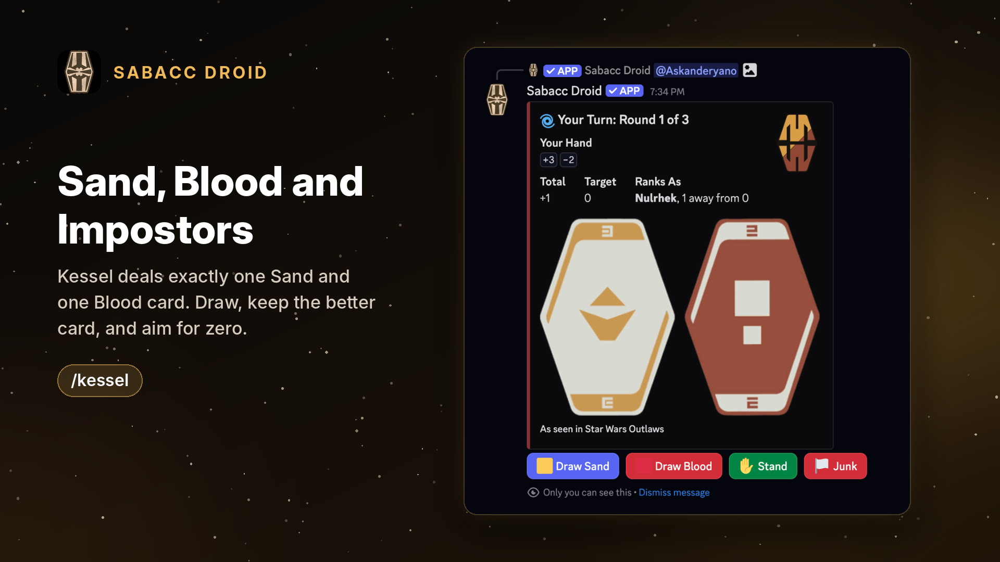
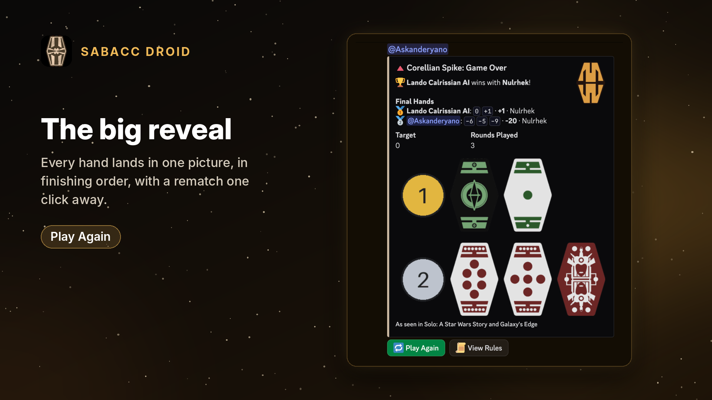

# Bot Lists

Where Sabacc Droid is listed outside Discord, and what each listing says, so they can all be kept in step. The App Directory listing inside Discord is in [discord-listing.md](discord-listing.md), and Aurebesh Droid has the same page ([bot-lists.md](https://github.com/TheAbubakrAbu/Aurebesh-Droid/blob/main/docs/bot-lists.md)).

Every listing belongs to the Discord account **masterthingw** (shown as Askanderyano), and each site is signed in to with Discord.

## Listings

Status as of November 24, 2026.

| Site | Listing | Status |
| --- | --- | --- |
| [top.gg](https://top.gg) | https://top.gg/bot/1306557976592515163 | Live |
| [Discord Bot List](https://discordbotlist.com) | https://discordbotlist.com/bots/sabaac-droid (short link `discord.ly/sabaac-droid`) | Live |
| [Discord Bots](https://discord.bots.gg) | https://discord.bots.gg/bots/1306557976592515163 | Live |
| [Discordlist](https://discordlist.gg) | https://discordlist.gg/bot/1306557976592515163 | Live |
| [Discord Extreme List](https://discordextremelist.xyz) | https://discordextremelist.xyz/en-US/bots/1306557976592515163 | Waiting for review |
| [Botlist.me](https://botlist.me) | https://botlist.me/bots/1306557976592515163 | Waiting for review (the site said a day at most) |
| [Topbot.gg](https://topbot.gg) | https://topbot.gg/en/bots/1306557976592515163 | Waiting for review |
| [TheDiscordList](https://thediscordlist.com) | https://thediscordlist.com/sabacc-droid | Waiting for review |
| [Radarcord](https://radarcord.net) | https://radarcord.net/bot/1306557976592515163 | Waiting for review (shown as "Not Approved" until then) |

A listing waiting for review is hidden until a moderator approves it. Most reviewers add the bot to a test server and try its commands, so it has to stay online until then.

### Servers the owner account must stay in

Several lists will only take a bot if its owner is in their Discord server, so masterthingw joined them:

- **Botlist.me:** if the owner leaves, the bot is removed from the site.
- **TheDiscordList**, **Topbot.gg** and **Radarcord:** reviewers contact the owner there.
- **Discord Extreme List** asks the same, and says the owner can leave once the bot is approved.
- **Bots on Discord** was joined too, but the site turned out to be closed to new bots, so that server can be left.

### Not listed

| Site | Why |
| --- | --- |
| [Discords](https://discords.com/bots) | Its add form says no bot with this ID exists (a fault on the site's side). Try again later. |
| [Bots on Discord](https://bots.ondiscord.xyz) | Closed to new bots: "you may only resubmit bots". |
| [DiscordPlace](https://discordplace.com/bots) | Needs a verification code pasted into the bot's description in the Developer Portal for a moment. Not done yet. |
| [DiscordBots.net](https://discordbots.net) (formerly Disforge) | Its Discord sign-in asks for permission to add the account to servers, so it was not used. |
| [discord.place](https://discord.place/bots) | The page did not load. |

[BotBlock](https://botblock.org/lists) keeps a list of which bot lists are still running.

## What every listing uses

The text is the App Directory text from [discord-listing.md](discord-listing.md), so all listings say the same thing.

- **Short description:** the App Directory summary (179 characters). Sites that allow fewer characters (top.gg 140, Topbot.gg 160) get the headline below.
- **Long description:** the App Directory expanded description written as Markdown, with real headings and a Screenshots section that shows the five images in [`docs/media`](media). It is below.
- **Website and privacy policy:** https://abubakrelmallah.com/star-wars/
- **Source code:** https://github.com/TheAbubakrAbu/Sabacc-Droid
- **Support server:** The Skywalker Order, https://discord.gg/58bzgDvnna. This invite never expires; it was made by Askanderyano on #skywalker-code.
- **Invite link:** `https://discord.com/oauth2/authorize?client_id=1306557976592515163`
- **Prefix:** `/` (slash commands only). **Library:** discord.py.

**Summary:**

```
Play the galaxy's legendary Star Wars card game on Discord! Challenge up to 8 players or face Lando Calrissian in Corellian Spike, Coruscant Shift, Kessel, and Traditional Sabacc.
```

**Headline** (for 140 or 160 characters):

```
Play Star Wars Sabacc on Discord! Up to 8 players or face Lando in Corellian Spike, Coruscant Shift, Kessel, and Traditional Sabacc.
```

**Long description** (Markdown):

````markdown
# Sabacc Droid | The Ultimate Star Wars Card Game on Discord!

Bring the galaxy's most legendary card game to your Discord server! Play Sabacc with friends or challenge Lando Calrissian in an immersive, interactive experience inspired by Star Wars.

## 🎮 Four Sabacc Variants

- **Corellian Spike:** As seen in Solo: A Star Wars Story and Galaxy's Edge. Draw, strategize, and aim for a hand totaling zero.
- **Coruscant Shift:** Inspired by Galactic Starcruiser. Roll the dice to determine the target number and suit.
- **Kessel Sabacc:** As seen in Star Wars Outlaws. Master Sand and Blood cards, Impostors, and Sylops.
- **Traditional Sabacc:** As seen in Star Wars Rebels. Aim for positive or negative 23 and call Alderaan to end the game!

## 🃏 Features

- Multiplayer games with up to 8 players
- Solo gameplay against Lando Calrissian
- Interactive buttons, custom card artwork, and private hands
- Automatic dealing, turn management, and scoring
- Customizable rounds, starting hands, and game settings
- Built-in rules for all four variants
- Random game mode for unexpected challenges

## 🚀 Getting Started

Use `/sabacc` to choose your game, `/random` for a surprise, or `/help` to learn the rules. You can also launch each variant directly using its dedicated slash command.

Whether you're a seasoned Sabacc player or just discovering the game, gather your friends, test your luck, and prove you've got what it takes to win!

May the best player win!

## 📸 Screenshots







Created by Abubakr Elmallah

Website: https://abubakrelmallah.com/star-wars/

Support: contact@abubakrelmallah.com
````

## What each site has

| Site | Short text | Tags and categories | Other settings |
| --- | --- | --- | --- |
| top.gg | Headline (140 at most) | Categories: card game, cards, entertainment, Fun, Game, Games, Star Wars, Star Wars Battlefront 2, Star Wars Galaxy of Heroes, star wars roleplay, Star Wars RP, Multiplayer (12, the most allowed). Language: English. | Repository, support server and website filled in. **Carding** was removed from the categories: it means credit card fraud. **Multiplayer** took its place. |
| Discord Bot List | Summary (191 at most) | Tags: Games, Fun, Roleplay (unchanged) | Website changed to the Star Wars page. |
| Discord Bots | Summary (200 at most) | None on this site | Library: discord.py. Website and support server changed (the support link pointed at the website before). |
| Discordlist | Summary (300 at most) | Tags: games, minigames, interactive, roleplay, english | Feature: Interactive buttons. Website and support server filled in. |
| Discord Extreme List | Summary (200 at most) | Category: Fun | Library: discord.py. Scopes: Bot and Application Commands. Banner: `banner.png` from this repo. Privacy policy: the website. AI content: no. NSFW: no. |
| Botlist.me | Summary | Tags: Game, Fun, Roleplay | Library: discord.py. |
| Topbot.gg | Headline (160 at most) | Category: Games. Tags: Slash commands, Open source | Pricing: Free. Commands: `/sabacc`, `/random`, `/corellian_spike`, `/coruscant_shift`, `/kessel`, `/traditional`, `/help`. No ownership proof was given, so the reviewer checks it instead. |
| TheDiscordList | Summary (200 at most) | Categories: Gaming, Fun. Tags: #star-wars, #sabacc, #card-game, #multiplayer | Custom URL: `sabacc-droid`. Website added as its one link. Ownership verification (optional) skipped. |
| Radarcord | Summary | Category: Fun |  |

## Changes

### November 24, 2026

- **Updated** top.gg, Discord Bot List, Discord Bots and Discordlist. They had the older text that starts "Test your strategy in Corellian Spike...". They now have the App Directory summary and long description, the screenshots, the Star Wars website link and the support server invite.
- **Submitted** to Discord Extreme List, Botlist.me, Topbot.gg, TheDiscordList and Radarcord.
- **Joined** the Discord servers of TheDiscordList, Topbot.gg, Botlist.me, Bots on Discord and Radarcord with masterthingw, which those lists require.
